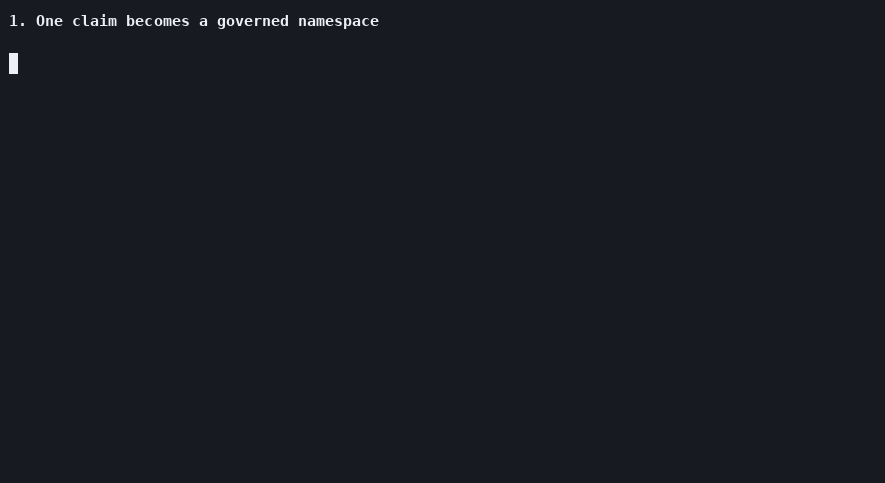
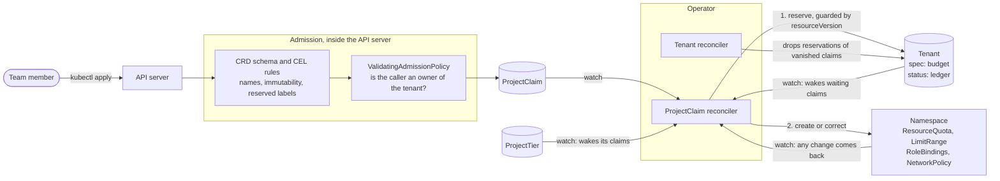

# ProjectClaim

[](https://github.com/mella7/project-claim/actions/workflows/ci.yml)
[](LICENSE)

A Kubernetes operator for self-service, multi-tenant namespaces on OpenShift/OKD and plain Kubernetes.

A team writes one small `ProjectClaim`. The operator creates the namespace with its quota, container defaults, role bindings, Pod Security level and network isolation, charges it to the team's budget, and keeps all of it that way. A manual edit is reverted within about a second. A claim that would take the team over budget is held without creating anything.



*A real session against the operator, recorded with [hack/record-demo.py](hack/record-demo.py). Only the typing is simulated.*

```yaml
apiVersion: platform.mella7.me/v1alpha1
kind: ProjectClaim
metadata:
  name: payments-staging
spec:
  projectName: payments-staging
  tenantRef: {name: payments}
  tier: standard
  access:
    requester: alice@example.com
    editorGroups: [payments-devs]
  quota:
    pods: "60"        # everything else comes from the tier
```

```console
$ kubectl get projectclaims,tenants
NAME               NAMESPACE          TENANT     TIER       PHASE   READY   AGE
payments-staging   payments-staging   payments   standard   Ready   True    4s

NAME       PROJECTS   MAX   CPU USED   CPU BUDGET   AGE
payments   1          10    4          24           4s

$ kubectl get resourcequota,limitrange,rolebinding,networkpolicy -n payments-staging -o name
resourcequota/projectclaim-quota
limitrange/projectclaim-limits
rolebinding.rbac.authorization.k8s.io/projectclaim-admin
rolebinding.rbac.authorization.k8s.io/projectclaim-edit
rolebinding.rbac.authorization.k8s.io/projectclaim-view
networkpolicy.networking.k8s.io/projectclaim-isolation
```

Written by hand on [controller-runtime](https://github.com/kubernetes-sigs/controller-runtime), in Go: about 2,300 lines of operator code and 1,700 lines of tests.

## Contents

- [The three resources](#the-three-resources)
- [How it works](#how-it-works)
- [What it guarantees, and the test behind each guarantee](#what-it-guarantees-and-the-test-behind-each-guarantee)
- [Try it in two minutes, without a cluster](#try-it-in-two-minutes-without-a-cluster)
- [Install on a cluster](#install-on-a-cluster)
- [Observability](#observability)
- [Security](#security)
- [Repository layout](#repository-layout)
- [Limits and what is next](#limits-and-what-is-next)

## The three resources

| Kind | Written by | What it holds |
|---|---|---|
| `ProjectTier` | Platform team | Defaults for a class of project: quota, container defaults, Pod Security level, whether isolation may be turned off, an optional lifetime. Changing a tier updates every project on it. |
| `Tenant` | Platform team | A team: who its owners are, which tiers it may use, a name prefix, a cap on projects, and a quota budget shared by all its projects. Its status is the ledger of what each project has reserved. |
| `ProjectClaim` | The team | A request for one namespace. Names its tenant and tier, says who gets access, and may override single quota values. |

All three are cluster-scoped. That is a requirement, not a preference: an owner reference from a namespace to a namespaced object is invalid, so only a cluster-scoped claim can own the namespace it creates.

## How it works



One reconcile of a claim, in order:

1. **Finalizer first.** It is added before anything is created, so a crash can never leave a namespace that no delete would clean up.
2. **Admit.** Check the claim against its tier and tenant (allowed tiers, name prefix, isolation rule), check that the namespace name is free or already ours, then reserve the quota in the tenant's ledger. A claim that fails here is held with a reason and gets nothing.
3. **Provision.** Create or correct the namespace and the objects in it. Each step compares desired with actual and writes only on a difference.
4. **Report.** Status is written once, at the end, and only if it changed.

The reconciler is handed nothing but a claim's name. It is never told what changed, so every step derives its work from current state and can run any number of times.

On delete, the API server only marks the claim. The operator deletes the namespace, waits until it is confirmed gone, releases the budget, and only then removes the finalizer.

[docs/design.md](docs/design.md) explains each decision and what was rejected.

## What it guarantees, and the test behind each guarantee

The suite runs both controllers against a real `kube-apiserver` and `etcd` (envtest): 48 specs plus table tests for the pure logic. In it the operator runs with exactly the `ClusterRole` it ships with, not as cluster admin, so a missing permission fails the tests instead of the first deployment.

| Guarantee | How it is kept | How it is tested |
|---|---|---|
| A settled project costs nothing | Desired state is deterministic, compared semantically, and status is written only on change | Every write call the operator makes is recorded. Three forced reconciles must produce zero. |
| Drift is corrected | Managed objects carry a controller reference and are watched | Delete the quota, edit the quota, lower the Pod Security label, add a subject to the admin binding. Each is undone. |
| A tenant never exceeds its budget | The reservation is an `Update` on the tenant's status carrying the `resourceVersion` that was read. A lost race is a conflict, and the check is redone on fresh data. | 12 claims that fit 4 at a time, reconciled by 4 workers in parallel. Exactly 4 are admitted. |
| A refused change never breaks a running project | The last admitted configuration stays, the claim reports `Degraded` | Raise a claim's quota beyond the budget. Namespace quota and ledger stay as they were. |
| The operator never touches a namespace it did not create | Ownership is checked by UID before anything is written. Handing a namespace over takes an explicit annotation. | Claim the name of an existing namespace. It keeps its labels, gets no owner reference, and survives the claim's deletion. |
| A claim outlives its namespace | The finalizer comes off only after the API server confirms the namespace is gone | The namespace is left stuck in `Terminating`. The claim, its finalizer and its reservation must all still be there. |
| `Retain` really retains | Owner references are removed from the namespace and everything in it before the claim goes | No object may still point at the deleted claim. |
| Only a tenant's owners can claim against it | A `ValidatingAdmissionPolicy` checks the caller against the tenant's owner list | Impersonated users: an owner, a group member, a stranger, an owner of another tenant, an RBAC-granted admin. |
| The ledger heals | The tenant controller drops reservations whose claim is gone, after asking the API server and not the cache | Strip a claim's finalizer by hand. Its reservation disappears. |

A passing test only means something if it can fail. `make mutation-test` removes each guarantee from a copy of the code and runs the spec that protects it:

```console
$ make mutation-test
[ 0] caught      the desired LimitRange ignores a default the API server applies
[ 1] caught      the adoption guard is gone
[ 2] caught      the finalizer is released as soon as deletion is requested
[ 3] caught      the budget is checked on the cache and written without a resourceVersion
[ 4] caught      claims do not watch their tenant
[ 5] caught      claims do not watch their tier
[ 6] caught      Retain leaves owner references behind
[ 7] caught      nobody cleans up after a claim whose finalizer was stripped
[ 8] caught      the operator's ClusterRole lacks the bind verb
[ 9] caught      the operator's ClusterRole cannot delete namespaces
[10] caught      the admission policy does not check who is asking

Every mutation was caught.
```

Two of these found real problems while the project was being built. Both are written up in [docs/testing.md](docs/testing.md).

## Try it in two minutes, without a cluster

You need Go 1.24 and `kubectl`. No Docker, no kind.

```bash
make sandbox       # terminal 1: a local API server and etcd with the CRDs installed
make run-sandbox   # terminal 2: the operator
```

```bash
# terminal 3
export KUBECONFIG=bin/sandbox.kubeconfig
kubectl apply -k config/samples
kubectl get projectclaims,tenants,projecttiers

make demo          # a scripted walk through drift, budget, adoption and deletion
```

The samples can be applied in any order. A claim whose tier or tenant does not exist yet waits as `Pending` and is admitted when they appear.

`make demo` checks 28 things and prints each one. A shortened run:

```console
== 2. Drift: delete and edit what the operator manages
   ok    deleted quota came back
   ok    edited quota was reverted to 60
   ok    lowered Pod Security level was reverted

== 3. Budget: 5 CPU, each project takes 2
   ok    second project fits (4 of 5 CPU)
   ok    third project is held: QuotaBudgetExceeded
   ok    and gets no namespace
         tenant "demo-shop" is out of budget (requests.cpu: wants 2, 1 free of 5)
   ok    raising the budget to 6 admits it, untouched

== 6. Deletion: the claim waits for its namespace
   ok    namespace deletion was requested
   ok    claim is still there, held by its finalizer
   ok    its 2 CPU are still reserved
   ok    namespace gone, then claim gone
   ok    budget released (2 projects left)
```

The sandbox is the control plane only. Pods are never scheduled, which does not matter here because the operator manages API objects and runs no workloads.

## Install on a cluster

Needs Kubernetes 1.30 or newer (for `ValidatingAdmissionPolicy`), or OpenShift 4.17 or newer.

```bash
make docker-build docker-push IMG=<registry>/project-claim:<tag>
make deploy IMG=<registry>/project-claim:<tag>
kubectl apply -k config/samples
```

`make deploy` installs the CRDs, the RBAC, the admission policy and a two-replica Deployment with leader election. To let people request projects, bind the `projectclaim-author` ClusterRole to them and list them as owners on their `Tenant`.

Tagged releases build a multi-arch image, sign it and attach an `install.yaml` pinned to the image digest. See [.github/workflows/release.yml](.github/workflows/release.yml).

## Observability

Next to the controller-runtime defaults (reconcile counts, durations, queue depth) the operator exports:

| Metric | Meaning |
|---|---|
| `projectclaim_claims{tenant,tier,phase}` | Claims by phase |
| `projectclaim_tenant_projects{tenant}` | Projects holding a reservation |
| `projectclaim_tenant_quota_allocated{tenant,resource}` | Reserved quota |
| `projectclaim_tenant_quota_budget{tenant,resource}` | Budget |
| `projectclaim_apply_total{kind,result}` | Outcome of each comparison of a managed object: `created`, `updated`, `unchanged`, `deleted`, `error` |

The first four are computed from the informer cache when Prometheus scrapes, so they cannot drift from the real state and cost the API server nothing. `projectclaim_apply_total` is the one to watch for trouble: in a settled cluster only `unchanged` grows, and a steady rate of `updated` means something keeps fighting the operator over an object.

[config/prometheus](config/prometheus) has a `ServiceMonitor` and five alerts, among them claims stuck terminating, tenants near their budget and that fight over objects.

Every decision is also visible where an operator of the cluster would look first:

```console
$ kubectl get events --field-selector involvedObject.name=payments-staging
TYPE      REASON           MESSAGE
Warning   TierNotFound     ProjectTier "standard" does not exist
Warning   TenantNotFound   Tenant "payments" does not exist
Normal    Applied          Namespace payments-staging created
Normal    Applied          ResourceQuota payments-staging/projectclaim-quota created
...
```

## Security

- **Least privilege, generated.** The `ClusterRole` is generated from markers next to the code that needs each permission, and the test suite runs the operator with that role.
- **No cluster-admin for handing out roles.** Kubernetes refuses to let anyone create a `RoleBinding` to a role whose permissions they do not hold. The operator holds only the `bind` verb on `admin`, `edit` and `view`, by name.
- **Tenant ownership at admission.** A controller cannot know who wrote an object. The API server can, so the check is a `ValidatingAdmissionPolicy` in CEL. There is no webhook to run, no certificate to rotate, and nothing that can be down.
- **A claim cannot weaken its own guardrails.** Reserved label prefixes are rejected by the schema, so `extraLabels` cannot set a Pod Security level. Names such as `kube-system` and `openshift-*` are rejected the same way.
- **Hardened pod.** Non-root, read-only root filesystem, all capabilities dropped, seccomp `RuntimeDefault`, no fixed UID so it runs under OpenShift's `restricted-v2` SCC. Metrics need a token that may `GET /metrics`.
- **Supply chain.** GitHub Actions are pinned to commits. The release workflow scans the image, signs its digest with cosign (keyless) and publishes an SBOM and build provenance. The image is distroless and static.

## Repository layout

```
api/v1alpha1/            The three API types. CRDs and DeepCopy code are generated from these.
cmd/main.go              Manager setup: cache, leader election, metrics, probes.
internal/controller/
  projectclaim_controller.go   Reconcile, admission, provisioning
  reserve.go                   Budget reservation against the tenant ledger
  ledger.go                    Budget arithmetic (pure)
  desired.go                   Desired state of every managed object (pure)
  apply.go                     Create-or-update and remove, with metrics and events
  delete.go                    Finalizer, namespace cleanup, Retain
  setup.go                     Watches, indexes, cache filter
  tenant_controller.go         Keeps the ledger honest
  *_test.go                    The suite
internal/metrics/        Prometheus collector
config/                  CRDs, RBAC, Deployment, admission policy, alerts, samples
hack/sandbox/            Local API server for trying the operator
hack/demo.sh             Scripted walkthrough with checks
hack/record-demo.py      Records docs/demo.gif from a live session
hack/mutate.py           Mutation checks
docs/                    Design decisions, testing notes
```

## Limits and what is next

- **Not yet run on OpenShift in CI.** The tests run against upstream Kubernetes 1.34 (envtest) and, in CI, kind. The OpenShift parts (project annotations, an SCC-compatible pod, the `policy-group` namespace labels in the NetworkPolicy) follow the documented conventions.
- **The budget limits quota, not usage.** It caps what projects may reserve. Actual consumption is still enforced per namespace by the `ResourceQuota`.
- **One API version.** A `v1beta1` would need a conversion strategy and a storage migration.
- **Create-or-update, not Server-Side Apply.** SSA would make field ownership explicit when other controllers manage the same objects. See [docs/design.md](docs/design.md#create-or-update-or-server-side-apply) for why it is not the default here.
- **Ideas:** egress policy per tier, an Argo CD `AppProject` per claim, an OLM bundle.

## Author

Mohamed Ali Mellah, [mella7.me](https://mella7.me), [github.com/mella7](https://github.com/mella7)

Apache-2.0
